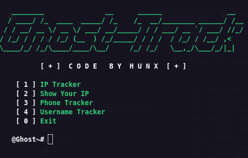
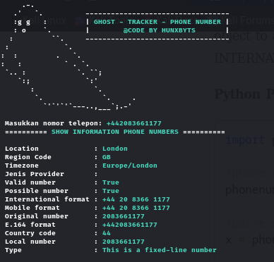
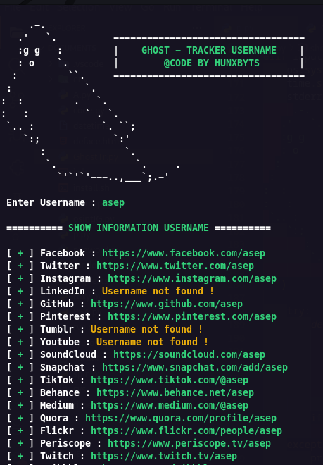

# GhostTrack
Useful tool to track location or mobile number, so this tool can be called osint or also information gathering



New update :
```Version 2.2```

### Instalation on Linux (deb)
```
sudo apt-get install git
sudo apt-get install python3
```

### Instalation on Termux
```
pkg install git
pkg install python3
```

### Usage Tool
```
git clone https://github.com/HunxByts/GhostTrack.git
cd GhostTrack
pip3 install -r requirements.txt
python3 GhostTR.py
```

Display on the menu ```IP Tracker```


on the IP Track menu, you can combo with the seeker tool to get the target IP
<details>
<summary>:zap: Install Seeker :</summary>
- <strong><a href="https://github.com/thewhiteh4t/seeker">Get Seeker</a></strong>
</details>

Display on the menu ```Phone Tracker```



on this menu you can search for information from the target phone number

Display on the menu ```Username Tracker```


on this menu you can search for information from the target username on social media

<details>
<summary>:zap: Author :</summary>
- <strong><a href="https://github.com/HunxByts">HunxByts</a></strong>
</details>

### Installation on Windows

1. Install Python 3 from the official Python website.
2. During installation, enable **Add python.exe to PATH**.
3. Install Git for Windows.
4. Open PowerShell and run:

```powershell
git clone https://github.com/HunxByts/GhostTrack.git
cd GhostTrack
python -m pip install -r requirements.txt
python GhostTR.py
```

If `python` does not work, try:

```powershell
py GhostTR.py
```

### Ethical Usage

This tool is intended for educational and authorized OSINT use only.

Do not use it to track, identify, or investigate people without clear permission.

Results from IP, phone number, and username lookups may be approximate, incomplete, or outdated.
